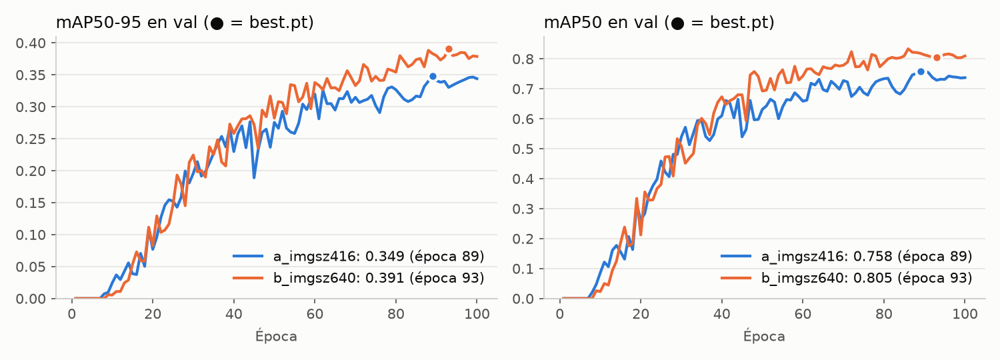
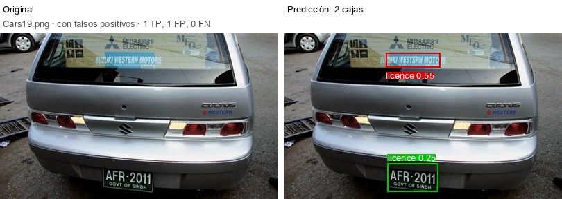
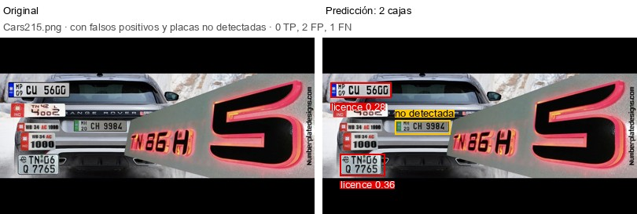
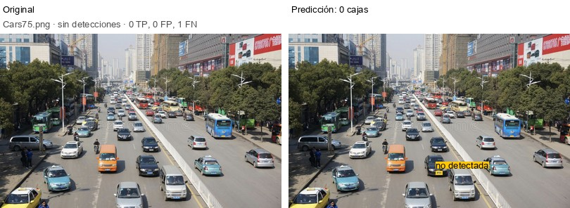

# Informe: detección de matrículas con YOLO entrenado desde cero

## Resumen

Se entrenó un detector de matrículas **YOLO26n desde pesos aleatorios**, en CPU, con un dataset de 433 imágenes anotadas. Se compararon dos configuraciones que solo difieren en el tamaño de imagen (`imgsz` 416 y 640) y se eligió con el split de validación. **La configuración elegida, `imgsz` 640, obtiene un mAP50 de 0.807 y un mAP50-95 de 0.425 en test.**

Las conclusiones principales son:

1. **El dataset tenía 131 imágenes duplicadas (30%).** Al dividirlo al azar, más de la mitad de test tenía una copia en train y las métricas salían infladas. Hubo que deduplicarlo y repetir los entrenamientos.
2. **La resolución importa:** 640 supera a 416 en 4.3 puntos de mAP50-95 en val, a cambio de 2.3 veces más tiempo por época.
3. **El ruido de anotación limita el mAP50-95.** Las copias duplicadas traían cajas distintas para la misma placa, con un IoU mediano de 0.83 entre ellas.
4. **En test hay dos tipos de error principales:** detecciones duplicadas de una misma placa y texto que se parece a una placa.

## 1. Modelo y entorno

| | |
|---|---|
| Librería | Ultralytics 8.4.175 (fijada en `poetry.lock`) |
| Arquitectura | YOLO26n: la variante más pequeña de YOLO26, la generación más reciente de esa versión estable. 2.57 M de parámetros y 5.9 GFLOPs. |
| Inicialización | Pesos aleatorios (`yolo26n.yaml`, `pretrained=False`) |
| Hardware | Apple M5 (4 núcleos de rendimiento + 6 de eficiencia), 16 GB, solo CPU |
| Software | Python 3.11.14, PyTorch 2.14.1 |

### Arquitectura frente a pesos entrenados

En Ultralytics, el mismo constructor `YOLO(...)` acepta dos tipos de archivo, y la diferencia decide si el modelo parte de cero:

| | `yolo26n.yaml` | `yolo26n.pt` |
|---|---|---|
| Contenido | Solo la arquitectura (capas y conexiones) | Checkpoint: arquitectura + pesos entrenados en COCO + metadatos |
| `model.ckpt` | `{}` (vacío) | Dict con `epoch`, `train_args`, `date`… |
| `model.ckpt_path` | `None` | Ruta al `.pt` |

El programa de entrenamiento garantiza que se parte de cero de tres formas:
- rechaza cualquier modelo que no sea `.yaml`;
- comprueba antes de entrenar que el checkpoint esté vacío;
- entrena con `pretrained=False`.

El resultado de la comprobación queda en `run_info.json` (`weights_check`). En el `best.pt` elegido, `train_args` registra `model: yolo26n.yaml` y `pretrained: False`.

### Docker frente a ejecución local

El proyecto incluye un entorno Docker reproducible (PyTorch solo CPU, imagen de 2 GB). Aun así, los experimentos finales se corrieron en local porque Docker resultó más lento en este equipo:

| Entorno | Segundos por época (`smoke`, `imgsz` 320) |
|---|---|
| Docker (Colima, 4 CPUs) | 26.6 |
| Mac local | 16.4 |

Darle 8 CPUs a la VM de Docker no aceleró nada (~46 s por época contra ~42 s con 4, en `imgsz` 416). PyTorch reparte cada operación en partes iguales entre sus hilos y espera al más lento, así que los núcleos de eficiencia del M5 frenan a los de rendimiento.

## 2. Datos

El dataset original tiene 433 imágenes con anotaciones Pascal VOC de una sola clase, `licence`. Las anotaciones se convirtieron al formato YOLO y se conservaron los XML originales para otros experimentos.

### Hallazgo: imágenes duplicadas

Al revisar la primera galería de test, dos imágenes (`Cars35` y `Cars357`) tenían predicciones idénticas. Comparar el hash de todas las imágenes reveló que:

- solo **302 de las 433 imágenes son distintas**: hay 131 copias byte a byte, y algunas fotos aparecen hasta 5 veces con otro nombre;
- en la división 70/20/10 al azar, **23 de las 43 imágenes de test** tenían una copia en train o val, y **37 de las 87 de val** una copia en train.

La fuga se nota sobre todo en el recall de test. Con el modelo de 640 entrenado sobre la división contaminada:

| Test (división contaminada) | Imágenes | Precision | Recall |
|---|---|---|---|
| Con copia en train/val | 23 | 0.846 | **0.957** |
| Nunca vistas | 20 | 0.857 | **0.750** |

Por eso se eliminaron los duplicados antes de dividir. De cada grupo se conservó la copia con el número más bajo, con su propia anotación, y las descartadas quedaron en `dataset/duplicates.csv`.

Las copias **no tenían anotaciones idénticas**. El IoU mediano entre las cajas de copias de la misma foto es **0.83**, y en 2 grupos ni siquiera coincide el número de placas. Es ruido de anotación: distintas personas marcaron la misma placa con bordes distintos.

### División final

| Split | Imágenes | Placas |
|---|---|---|
| train | 211 | 233 |
| val | 60 | 69 |
| test | 31 | 32 |
| **Total** | **302** | **334** |

El 38% de las placas de train (88 de 233) ocupa menos del 1% de la imagen, lo que motiva comparar resoluciones.

## 3. Experimentos

Siguiendo el consejo de empezar en pequeño, primero se corrió una prueba rápida (`smoke`: 3 épocas, `imgsz` 320, lote 8). Sirvió para comprobar el flujo completo, medir el tiempo por época y verificar la reproducibilidad: dos corridas idénticas dieron pérdidas y métricas iguales en cada época.

Después se compararon dos configuraciones que **solo difieren en `imgsz`**; un test automático lo comprueba:

| | A | B |
|---|---|---|
| `imgsz` | **416** | **640** |
| Modelo | `yolo26n.yaml` | `yolo26n.yaml` |
| Épocas / paciencia | 100 / 30 | 100 / 30 |
| Lote | 16 | 16 |
| Semilla | 42, determinista | 42, determinista |
| Optimizador y augmentations | por defecto | por defecto |

Cada experimento es un YAML en `configs/experiments/` y se repite con un comando. Además de los pesos (`best.pt`, `last.pt`) y las curvas, cada corrida registra en `run_info.json` las épocas, el tamaño de imagen, el lote, el tiempo y el hardware.

## 4. Elección con validación



| Val (`best.pt`) | A · 416 | B · 640 |
|---|---|---|
| Precision | 0.753 | **0.844** |
| Recall | **0.754** | 0.681 |
| mAP50 | 0.758 | **0.805** |
| mAP50-95 | 0.348 | **0.391** |
| Mejor época | 89 | 93 |
| Tiempo de entrenamiento | **22.9 min** (13.7 s/época) | 51.7 min (31.0 s/época) |

**Se eligió B** por su mayor mAP50-95 en val: +4.3 puntos, y +4.7 en mAP50.
- **Durante el entrenamiento:** las dos curvas se cruzan varias veces hasta la época 59. A partir de ahí, B queda siempre por encima.
- **Paciencia:** ninguna configuración se detuvo antes por la paciencia; las dos lograron su mejor resultado cerca del final.
- **Costo:** B tarda 2.3 veces más por época y tiene algo menos de recall en val.

Las curvas completas de entrenamiento están en [`figures/b_imgsz640_results.png`](figures/b_imgsz640_results.png) y [`figures/a_imgsz416_results.png`](figures/a_imgsz416_results.png). La curva PR de B está en [`figures/b_imgsz640_pr_curve.png`](figures/b_imgsz640_pr_curve.png), y el detalle de la comparación en [`comparacion.md`](comparacion.md).

## 5. Evaluación en test

El split test se usó una sola vez, con el modelo ya elegido.

| Test · B (`models/yolo26n_b_imgsz640_best.pt`) | |
|---|---|
| mAP50 | **0.807** |
| mAP50-95 | **0.425** |
| Precision / Recall (Ultralytics) | 0.808 / 0.790 |

Con un umbral fijo de confianza 0.25 y acierto con IoU ≥ 0.5, que es el criterio de la galería, a nivel de cajas hay **27 aciertos, 13 falsos positivos y 5 placas no detectadas** (precision 0.675, recall 0.844). La precision es más baja que la de Ultralytics porque esta usa el umbral de confianza que maximiza F1, y 0.25 deja pasar más detecciones débiles. Con solo 32 placas, cada error mueve las métricas unos 3 puntos.

### Galería

[`test_predictions/index.html`](test_predictions/index.html) muestra cada imagen de test con la original a la izquierda y la predicción con su confianza a la derecha. Las imágenes están agrupadas por resultado: 18 correctas, 8 con falsos positivos, 2 mixtas y 3 sin detecciones. Las predicciones en formato YOLO con confianza están en `test_predictions/predictions/`.

| | |
|---|---|
|  | **Texto confundido con una placa.** El letrero "SUZUKI WESTERN MOTORS" se detecta con 0.55, más que la placa real (0.25). |
|  | **Error de anotación.** El collage tiene 5 placas y solo una está etiquetada; las dos detecciones "falsas" son placas reales. |
|  | **Placa diminuta.** Ocupa el 0.05% de la imagen; en train solo 3 de 233 placas ocupan menos del 0.1%. |

### Análisis de errores

- **Detecciones duplicadas:** 7 de los 13 falsos positivos son una segunda caja sobre una placa que el modelo ya acertó. YOLO26 no aplica NMS en inferencia y, con tan pocos datos, todavía produce duplicados con confianza parecida.
- **Texto parecido a una placa:** letreros y rótulos rectangulares, como en `Cars19`.
- **Errores de anotación:** placas reales sin etiquetar, como en `Cars215`, penalizan al modelo cuando acierta.
- **Imágenes sin detecciones (3).** Fallan por razones distintas:
  - `Cars75`: una placa diminuta en una escena de tráfico.
  - `Cars114`: un primer plano de una placa decorativa que ocupa el 78% de la imagen, cuando ninguna placa de train supera el 50%.
  - `Cars23`: una placa normal rodeada de textos grandes ("POLICE", "9214").

## 6. Conclusiones

1. **Revisar los datos antes de confiar en las métricas.** El 30% del dataset eran duplicados. Sin detectarlos, el mAP50-95 de val de B habría sido 0.469 en lugar de 0.391, y el recall en test habría parecido mucho mejor de lo que es. El problema apareció inspeccionando la galería, no en las métricas.
2. **Más resolución ayuda con placas pequeñas.** `imgsz` 640 supera a 416 en todas las métricas de val salvo el recall, al costo de más del doble de tiempo.
3. **El mAP50-95 tiene un techo impuesto por las etiquetas.** Si dos anotadores marcan la misma placa con un IoU de ~0.83, los umbrales de 0.90–0.95 penalizan diferencias que son ruido. El mAP50 (0.81 en test) refleja mejor la calidad de la detección.
4. **Entrenar desde cero con 211 imágenes es viable pero limitado.** El modelo aprende a localizar placas típicas, pero falla en los extremos de tamaño y con textos parecidos, que casi no aparecen en train.
5. **Entrenar más no garantizó mejoras grandes.** En las últimas 20 épocas, el mAP50-95 de val osciló en un rango de 0.04 (A) y 0.03 (B), sin una tendencia clara al alza.
6. **La reproducibilidad depende del entorno.** Con la misma semilla, el resultado se repite exacto en el mismo equipo, pero cambia con el número de hilos de CPU o la plataforma.

### Posibles mejoras

- **Suprimir duplicados:** aplicar NMS o subir el umbral de confianza.
- **Corregir las anotaciones:** etiquetar las placas que faltan y unificar las cajas inconsistentes.
- **Ampliar el dataset:** añadir placas muy pequeñas y primeros planos, que hoy no están representados.
- **Partir de pesos preentrenados:** fuera del alcance de esta práctica, pero es la mejora esperable más grande con tan pocos datos.

## Reproducción

```bash
poetry install
# Datos: deduplicar, dividir y convertir a YOLO
poetry run python -m yolo_license_plates.data.split_dataset \
  ~/Downloads/dataset-matriculas/images --annotations ~/Downloads/dataset-matriculas/annotations
poetry run python -m yolo_license_plates.data.voc_to_yolo
# Entrenamiento y elección
poetry run python -m yolo_license_plates.training.train --config configs/experiments/a_imgsz416.yaml
poetry run python -m yolo_license_plates.training.train --config configs/experiments/b_imgsz640.yaml
poetry run python -m yolo_license_plates.training.compare runs/a_imgsz416 runs/b_imgsz640
poetry run python -m yolo_license_plates.training.plot_runs runs/a_imgsz416 runs/b_imgsz640
# Test y galería
poetry run python -m yolo_license_plates.evaluation.predict_gallery --weights models/yolo26n_b_imgsz640_best.pt
```
